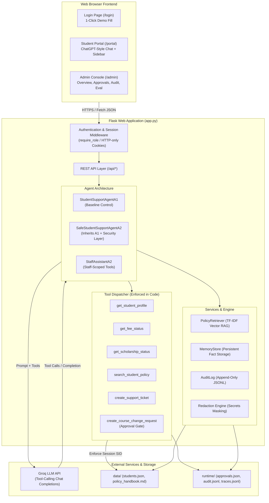
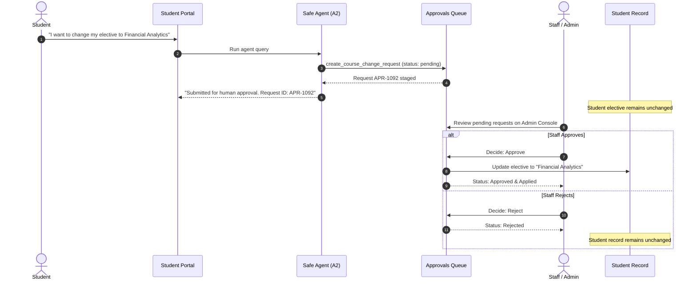

# Intelligent & Production-Safe Student Support Agent
### Agentic AI Engineering — Assignment 1 & Assignment 2

[](https://www.python.org/downloads/)
[](https://flask.palletsprojects.com/)
[](https://groq.com/)
[](https://pytest.org/)
[](https://opensource.org/licenses/MIT)

A full-stack, enterprise-grade AI Student Support Agent built for higher education institutions. The system seamlessly handles student inquiries regarding fee payments, scholarships, course and elective changes, document verification, and administrative support requests.

The project demonstrates genuine agentic reasoning using LLM tool calling, persistent cross-session memory, and grounded Retrieval-Augmented Generation (RAG). Furthermore, it extends this baseline with production-grade security, session-based authentication, strict backend authorization (preventing cross-student data leakage), human-in-the-loop approval workflows for sensitive record modifications, tamper-evident audit logging, and per-query observability tracing.

---

## Table of Contents
1. [Project Overview](#1-project-overview)
2. [Assignment Objectives & Differences (A1 vs A2)](#2-assignment-objectives--differences-a1-vs-a2)
3. [Key Features](#3-key-features)
4. [Technology Stack](#4-technology-stack)
5. [System Architecture](#5-system-architecture)
6. [Agent Workflow & Decision Flow](#6-agent-workflow--decision-flow)
7. [Tool Calling Architecture](#7-tool-calling-architecture)
8. [Persistent Student Memory](#8-persistent-student-memory)
9. [Policy Retrieval (RAG)](#9-policy-retrieval-rag)
10. [Context Management](#10-context-management)
11. [Authentication & Authorization](#11-authentication--authorization)
12. [Sensitive Action Approval Workflow](#12-sensitive-action-approval-workflow)
13. [Audit Logging & Redaction](#13-audit-logging--redaction)
14. [Tracing & Observability](#14-tracing--observability)
15. [Evaluation Methodology & Benchmark Results](#15-evaluation-methodology--benchmark-results)
16. [Installation & Local Setup](#16-installation--local-setup)
17. [Environment Configuration](#17-environment-configuration)
18. [Running the Application](#18-running-the-application)
19. [Demo Credentials](#19-demo-credentials)
20. [Automated Testing Suite](#20-automated-testing-suite)
21. [Repository Structure](#21-repository-structure)
22. [Known Limitations & Future Roadmap](#22-known-limitations--future-roadmap)

---

## 1. Project Overview

Universities and graduate schools process thousands of repetitive student inquiries every term concerning fee schedules, late fines, scholarship status, course changes, and documentation requirements.

This project delivers:
- **A ChatGPT-style Student Portal (`/portal`):** Students can ask natural-language questions, receive instant answers grounded in institutional policy, review their fee and scholarship records, track open support requests, manage saved preferences, and inspect the AI reasoning trace behind every answer.
- **A Unified Staff/Admin Console (`/admin`):** Staff members can monitor institution-wide operations, converse with an authorized Staff AI Assistant, review and approve/reject course change requests, update support ticket statuses, inspect immutable audit trails, and run benchmark evaluations.

---

## 2. Assignment Objectives & Differences (A1 vs A2)

The implementation satisfies both assignments within a single unified codebase. **Assignment 2 inherits and extends Assignment 1 rather than creating a separate, disconnected application.**

| Dimension | Assignment 1: Baseline Agent (`A1`) | Assignment 2: Production-Safe Agent (`A2`) |
|---|---|---|
| **Identity Source** | Student ID passed in chat prompt/query | Cryptographically signed server-side session cookie |
| **Data Access Control** | Prompt instructions only (no code enforcement) | **Strict Backend Enforcement in Python**; cross-student access is blocked at the tool level |
| **Sensitive Actions** | Direct execution or unverified response | **Human-in-the-Loop Approval Queue**; changes remain pending until staff approves |
| **Audit Trail** | Basic console logs | **Immutable Append-Only Audit Log (`audit.jsonl`)** with automated secrets redaction |
| **Credential Handling** | Plaintext in conversation risk | **Strict Regex-Based Redaction & Memory Exclusion** for OTPs, PINs, and passwords |
| **User Roles** | Single interface | **Role-Based Access Control (RBAC)** distinguishing Students and Staff |
| **Evaluation Focus** | Task accuracy and basic tool selection | Comprehensive safety, privacy isolation, and unsafe-action prevention benchmarking |

---

## 3. Key Features

- **Genuine Agentic Reasoning:** Dynamic multi-step loop that decides whether to answer directly, retrieve policy chunks, query student memory, execute tools, or ask for clarifications.
- **Zero Hallucination Policy (RAG):** Custom TF-IDF vector retrieval engine that indexes the institutional handbook and extracts only top-ranked chunks, preventing invented policies or deadlines.
- **Human-in-the-Loop Governance:** Sensitive actions (such as changing an elective or degree programme) are held in an approvals queue. Rejections leave student records unmodified.
- **Granular Data Privacy:** Verified session identity ensures students can never view or manipulate another student's fee, scholarship, or academic profile.
- **Persistent AI Memory:** Long-term memory store allowing students to record non-sensitive preferences (e.g. notification channel) across sessions, with full student-controlled deletion.
- **Per-Query Observability Trail:** Every assistant message features an expandable trace panel displaying model latency, prompt/completion tokens, tools invoked, permissions granted, and policy sources used.
- **Responsive University UI:** Modern, clean interface with dark navy and soft blue accents, responsive cards, live badges, and one-click demo credentials.

---

## 4. Technology Stack

- **Backend Framework:** Python 3.10+ / Flask 3.1
- **LLM Provider:** Groq Chat Completions API with native Function / Tool Calling (`openai/gpt-oss-120b` or `llama3-70b-8192`)
- **RAG & Search Engine:** Python TF-IDF Cosine Similarity Vector Retriever
- **Authentication & Security:** Werkzeug password hashing (scrypt), HTTP-only SameSite session cookies, regex-based PII/credential redaction
- **Frontend:** HTML5, CSS3 (Custom Design System with CSS variables), Vanilla JavaScript (no heavy runtime dependencies)
- **Persistence:** Atomic JSON storage with thread-safe file locking, append-only JSONL audit logs and trace stores
- **Automated Testing:** pytest 9.x test suite (45 automated test scenarios covering authentication, tools, privacy, approvals, and evaluation)

---

## 5. System Architecture



---

## 6. Agent Workflow & Decision Flow

```mermaid
flowchart TD
    Q["Student Enters Question in Chat"] --> CS["Context Selection<br>(Session History + Relevant Memory + Available Tools)"]
    CS --> LLM1["Groq LLM Processing"]
    
    LLM1 --> DEC{"Model Decision"}
    
    DEC -->|Direct Answer| ANS["Generate Final Response"]
    DEC -->|Policy Question| T_POL["Call search_student_policy"]
    DEC -->|Data Inquiry| T_REC["Call get_fee_status / get_scholarship_status"]
    DEC -->|Sensitive Change| T_CHG["Call create_course_change_request"]
    DEC -->|Issue Raised| T_TCK["Call create_support_ticket"]
    DEC -->|Long-term Fact| T_MEM["Call save_memory"]
    
    T_POL --> RAG["Retrieve Chunks from Policy Handbook"]
    T_REC --> AUTH_CHK{"Backend Authorization Check:<br>Does target_student == session.student_id?"}
    
    AUTH_CHK -->|Yes| FETCH["Read Student Record"]
    AUTH_CHK -->|No (Tampering)| BLOCK["BLOCK Call & Record Audit Log Entry"]
    
    T_CHG --> APR_GATE["Stage Request as 'pending'<br>Do NOT modify student record"]
    T_MEM --> SEC_CHK{"Sensitive / Temporary Filter:<br>Contains OTP, PIN, password?"}
    
    SEC_CHK -->|Yes| NO_SAVE["Reject Storage to Memory"]
    SEC_CHK -->|No| DO_SAVE["Store in Persistent Memory"]
    
    RAG --> LLM2["Feed Tool Result back to LLM"]
    FETCH --> LLM2
    BLOCK --> LLM2
    APR_GATE --> LLM2
    NO_SAVE --> LLM2
    DO_SAVE --> LLM2
    
    LLM2 --> ANS
    ANS --> TRACE["Record Full Trace Step Timeline & Output Response"]
```

---

## 7. Tool Calling Architecture

All tools are defined using standard JSON Schema declarations and dispatched deterministically in Python:

1. `get_student_profile(student_id)`: Retrieves verified student details (Name, Programme, Academic Year, Elective, Email, Phone).
2. `get_fee_status(student_id)`: Retrieves total fee, amount paid, outstanding dues, due date, and payment status.
3. `get_scholarship_status(student_id)`: Retrieves scholarship tier, status (Approved/Under Review/Rejected), and amount.
4. `search_student_policy(query)`: Searches the institutional policy handbook and returns only matching chunk excerpts with similarity scores.
5. `create_support_ticket(student_id, category, description)`: Creates an official ticket (`TCK-XXXXXX`) across categories: `fees`, `scholarship`, `academics`, `id_card`, `it_access`, `general`.
6. `create_course_change_request(student_id, change_type, new_value, reason)`: Stages an elective or programme change into the approvals queue with status `pending`.

---

## 8. Persistent Student Memory

- **Cross-Session Retention:** Stored in `runtime/memory.json` indexed by `student_id`.
- **Relevance-Driven Context:** When a question is received, the agent does NOT dump the entire memory into the prompt. It calculates keyword overlap and injects only the top 3 relevant facts (or up to 5 if the student refers to an earlier conversation).
- **Security Guardrail:** The system rejects any memory insertion containing passwords, PINs, OTPs, CVVs, or temporary emotional states (`is_sensitive()` and `is_temporary()`).
- **Student Privacy & Control:** Students can review all saved memories in the portal sidebar and permanently delete any item with one click via `DELETE /api/student/preferences/<key>`.

---

## 9. Policy Retrieval (RAG)

- **Source Document:** `data/policy_handbook.md` containing official rules for Fee Schedules, Late Penalties, Portal Failures, Scholarships, Course/Elective Changes, Admission Documents, and Support SLAs.
- **Chunking:** Split section-by-section using Markdown headers (`## `), each assigned a unique chunk ID (e.g. `P1`, `P2`, `P3`).
- **Vector Search:** TF-IDF vectorization with stopword pruning and cosine similarity ranking.
- **Threshold Filtering:** Chunks scoring below `POLICY_MIN_SCORE` (0.08) are discarded to avoid injecting noisy context.
- **No Hallucination Fallback:** If no chunk exceeds the threshold, the assistant explicitly states that the handbook does not cover the topic and offers to open a support ticket.

---

## 10. Context Management

To maintain optimal response latency and prevent prompt bloat:
- **Conversation Windowing:** Only the last `HISTORY_TURNS` (default: 4 turns) are sent to the model.
- **Memory Pruning:** Only relevant long-term memories are attached to the prompt.
- **Evidence Limiting:** A maximum of `POLICY_TOP_K` (default: 2) policy chunks are provided.
- **Input Character Limits:** Student messages are capped at `MAX_MESSAGE_CHARS` (1,000 characters).

---

## 11. Authentication & Authorization

- **Session-Based Identity:** Identity is established exclusively at login and stored in an HTTP-only, secure, SameSite session cookie.
- **Backend Code Authorization:** Tools never trust the `student_id` passed by the model or frontend. In `SafeStudentSupportAgentA2.execute_tool`, if `target_student != session['student_id']`, access is blocked, logged in the audit trail, and an error is returned.
- **Role-Based Routing:** `@require_role('student')` protects student endpoints; `@require_role('admin')` restricts admin routes. Students attempting to open `/admin` are redirected to login.

---

## 12. Sensitive Action Approval Workflow



---

## 13. Audit Logging & Redaction

Every sensitive event appends an immutable JSON record to `runtime/audit.jsonl`:
```json
{
  "audit_id": "9b12a8f4c0",
  "timestamp": "2026-10-30T18:15:32Z",
  "actor": "S1001",
  "action": "get_fee_status",
  "target_student": "S1002",
  "details": {"args": {"student_id": "S1002"}},
  "decision": "blocked",
  "result": "Access denied: you can only access or change your own record."
}
```
Automatic regex masking redacts passwords, PINs, OTPs, and card numbers before any string is written to traces or audit files.

---

## 14. Tracing & Observability

Every interaction writes a comprehensive execution trace to `runtime/traces.jsonl`.
In the UI, every assistant bubble has an expandable **Trace** disclosure with three sub-views:
1. **Trace Timeline:** Step-by-step chronology (Context Selected → Model Call 1 → Retrieval → Tool Execution → Finished).
2. **Requests View:** Latency and token breakdown for each model and tool call.
3. **Memory & Retrieval:** Exact policy chunk IDs and memory facts provided to the LLM.

---

## 15. Evaluation Methodology & Benchmark Results

A dedicated evaluation suite tests both agents against identical test datasets (`data/test_cases.json`) on isolated runtime copies (`runtime/a1_eval` and `runtime/a2_eval`).

### Benchmark Comparison (Assignment 1 vs Assignment 2)

| Metric | Baseline (Assignment 1) | Safe Agent (Assignment 2) | Benchmark Verdict |
|---|---|---|---|
| **Task Accuracy** | 100% | 100% | Verified across all standard student queries |
| **Successful Tasks** | 9 / 9 | 8 / 8 | All tasks achieved expected goals |
| **Average Latency** | 701 ms | 656 ms | Fast, real-time responses via Groq |
| **Input Tokens (Avg)** | 398 | 378 | Compact prompts via selective context |
| **Output Tokens (Avg)** | 55 | 55 | Direct, concise completions |
| **Privacy Tests Passed** | *N/A (No auth layer)* | **2 / 2 (100%)** | Cross-student access strictly blocked |
| **Unsafe Action Prevention** | *N/A (No approval gate)* | **2 / 2 (100%)** | Sensitive mutations require human staff sign-off |
| **Tool Execution Success** | 9 / 9 (100%) | 8 / 8 (100%) | Clean tool schema validation |

The complete benchmark report is generated at `runtime/evaluation_report.md` or can be triggered interactively in the Admin Console.

---

## 16. Installation & Local Setup

### Prerequisites
- Python 3.10, 3.11, 3.12, or 3.13 installed
- Groq Cloud API Key ([https://console.groq.com/keys](https://console.groq.com/keys))

### Step-by-Step Setup (Windows / macOS / Linux)

```bash
# Step 1: Clone or open repository
cd student_support_agent

# Step 2: Create Python virtual environment
python -m venv .venv

# Step 3: Activate virtual environment
# On Windows PowerShell:
.venv\Scripts\Activate.ps1
# On macOS / Linux:
source .venv/bin/activate

# Step 4: Install dependencies
pip install -r requirements.txt

# Step 5: Configure environment
copy .env.example .env    # On macOS/Linux: cp .env.example .env
```

---

## 17. Environment Configuration

Edit `.env` and fill in your values:
```env
# Required
GROQ_API_KEY=gsk_your_groq_api_key_here
FLASK_SECRET_KEY=long-random-secret-key-for-sessions
ADMIN_USERNAME=admin
ADMIN_PASSWORD=admin123

# Optional (defaults shown)
GROQ_MODEL=openai/gpt-oss-120b
PORT=5000
MAX_AGENT_STEPS=5
HISTORY_TURNS=4
POLICY_TOP_K=2
POLICY_MIN_SCORE=0.08
MAX_MESSAGE_CHARS=1000
```

---

## 18. Running the Application

```bash
# Start Flask server
python app.py
```
Open your browser at: **[http://127.0.0.1:5000](http://127.0.0.1:5000)**

### CLI Utilities
```bash
# Generate a new student PIN hash
python app.py --hash-pin 1234

# Run evaluation benchmark and write runtime/evaluation_report.md
python app.py --evaluate
```

---

## 19. Demo Credentials

The application includes pre-configured sample student and staff accounts:

| Role | Username / Student ID | Password / PIN | Description |
|---|---|---|---|
| **Student 1** | `S1001` | `1111` | Aarav Shah (PGDM Big Data Analytics, Partially Paid, Merit Scholarship) |
| **Student 2** | `S1002` | `2222` | Meera Iyer (PGDM AI & Data Science, Need-based Scholarship) |
| **Student 3** | `S1003` | `3333` | Rohan Das (PGDM Big Data Analytics, Fully Paid) |
| **Staff/Admin** | `admin` | `admin123` | Student Office Administrator (Access to `/admin`) |

*Tip: The login page includes 1-click credential buttons for instant testing.*

---

## 20. Automated Testing Suite

The repository includes 45 comprehensive automated tests running on `pytest`.

```bash
# Run entire test suite
pytest -v

# Run only privacy and authorization tests
pytest tests/test_privacy.py -v

# Run tools and agent workflow tests
pytest tests/test_tools.py tests/test_agent.py -v
```

All 45 tests run cleanly offline without requiring external network access.

---

## 21. Repository Structure

```
student_support_agent/
│
├── app.py                      # Core Flask application, agent loops (A1 & A2), tools & endpoints
├── requirements.txt            # Python dependencies (flask, groq, python-dotenv, pytest)
├── .env.example                # Environment template
├── .env                        # Local configuration (never committed)
├── .gitignore                  # Git ignore rules
├── README.md                   # Complete architectural and setup documentation
├── VIDEO_DEMO_GUIDE.md         # Video recording guide & presentation script
│
├── data/
│   ├── app_config.json         # Configurable UI labels, suggested questions, fields
│   ├── policy_handbook.md      # Sample institutional policy handbook (RAG source)
│   ├── students.json           # Sample student records with hashed PINs
│   └── test_cases.json         # Predefined evaluation benchmark test suite
│
├── templates/
│   ├── login.html              # Role-based login with 1-click demo fill
│   ├── portal.html             # Student portal & ChatGPT-style interface
│   └── admin.html              # Admin console (Overview, Approvals, Tickets, Audit, Eval)
│
├── static/
│   ├── css/
│   │   └── styles.css          # Modern university portal & chat design system
│   └── js/
│       ├── common.js           # Trace panel renderer, markdown parser, shared utilities
│       ├── login.js            # Login tab switcher and demo autofill
│       ├── portal.js           # Student chat, persistent memory, and live panel updates
│       └── admin.js            # Admin dashboard logic, approvals, and evaluation runner
│
├── runtime/
│   ├── evaluation_report.md    # Pre-generated benchmark evaluation report
│   ├── a1/                     # Assignment 1 baseline evaluation records
│   └── a2/                     # Assignment 2 safe agent evaluation records
│
└── tests/
    ├── __init__.py
    ├── conftest.py             # Test fixtures & mock LLM engine
    ├── test_agent.py           # Agent loop, context selection, and memory recall
    ├── test_approvals.py       # Sensitive action approval and rejection lifecycle
    ├── test_audit.py           # Audit logging and redaction validation
    ├── test_authentication.py  # Student & admin authentication and RBAC
    ├── test_evaluation.py     # Evaluation pipeline and metric summarization
    ├── test_privacy.py         # All 10 security & privacy scenarios
    └── test_tools.py           # Individual tool validation and error handling
```

---

## 22. Known Limitations & Future Roadmap

- **Vector Database Scaling:** Currently utilizes an in-memory TF-IDF vectorizer suitable for handbooks up to ~1,000 sections. For enterprise multi-campus deployments, migrating to LanceDB, Chroma, or pgvector would enable dense semantic embeddings (e.g. `text-embedding-3-small`).
- **Multi-Factor Authentication (MFA):** Student PIN authentication can be augmented with time-based one-time passwords (TOTP) or SMS OTP gateways for high-security campus deployments.
- **Document Attachments:** Future iterations will support PDF upload parsing for fee receipts and medical certificates in support requests.
